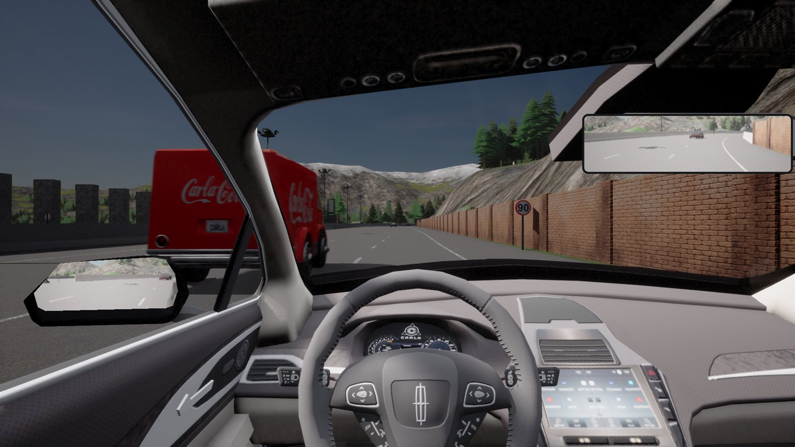
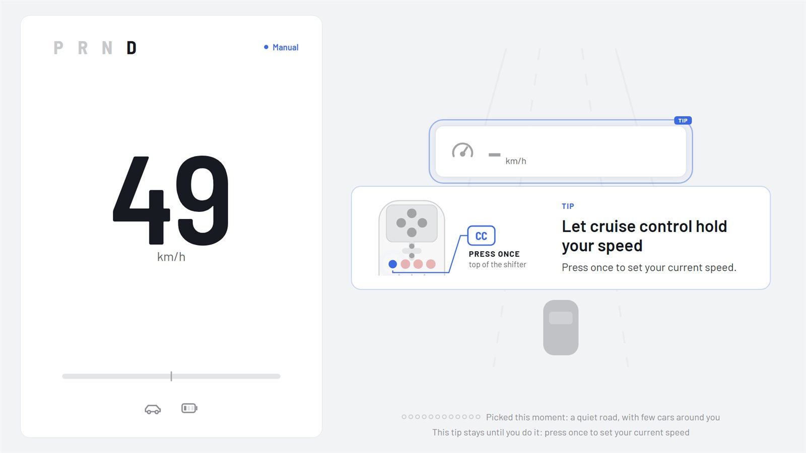
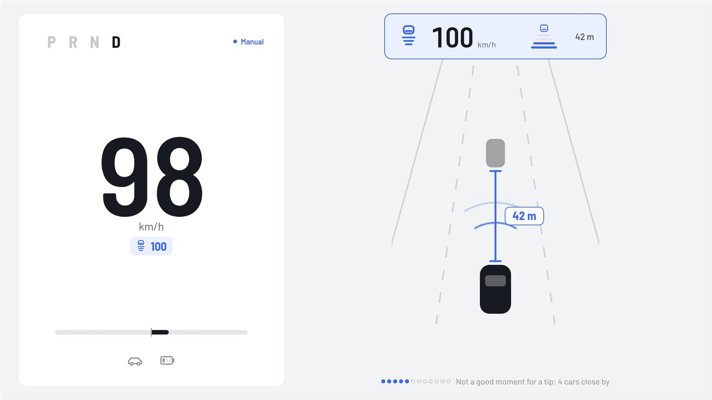
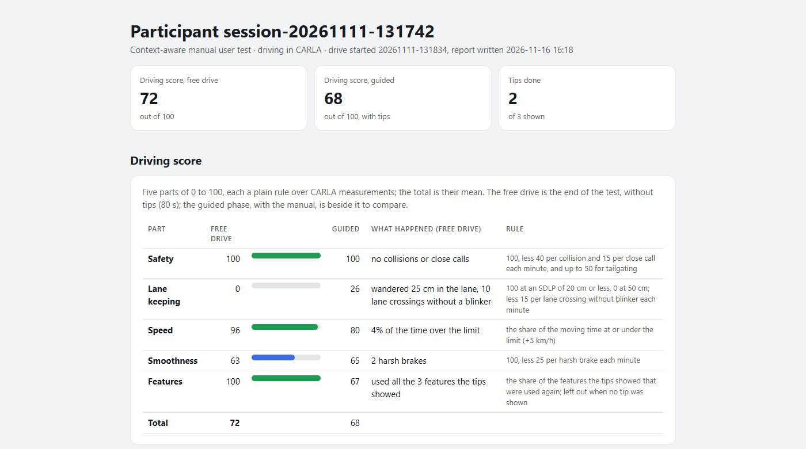
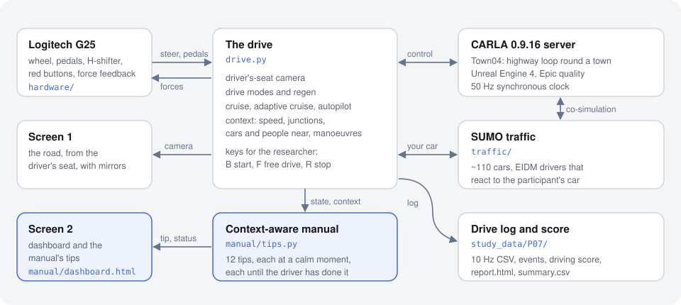
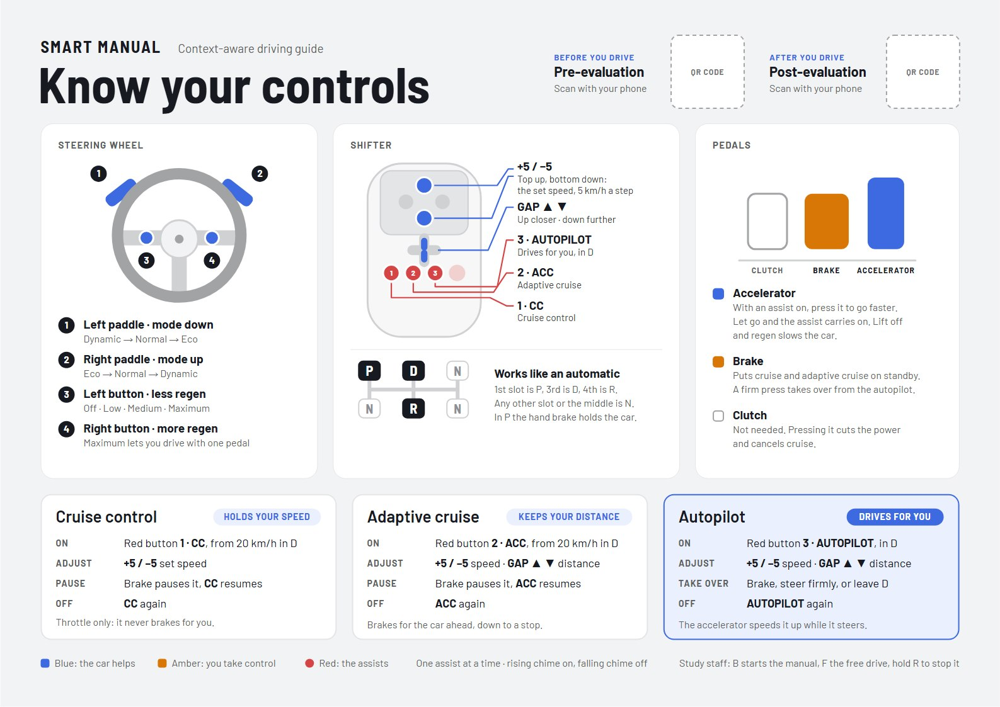

<h1 align="center">&nbsp;Context-aware manual</h1>

<p align="center">
  <b>A driving-simulator user study of an AI vehicle manual that teaches you the car while you drive.</b><br>
  Like a game tutorial: each feature is explained at a calm moment, on a second screen, and stays until you have tried it.
</p>

<p align="center">
  
  
  
  
  
  <a href="LICENSE"></a>
</p>

<p align="center">
  <a href="#quick-start">Quick start</a> ·
  <a href="#running-a-user-test">Running a user test</a> ·
  <a href="#the-tips">The tips</a> ·
  <a href="#how-it-works">How it works</a> ·
  <a href="#the-g25">The G25</a> ·
  <a href="#traffic">Traffic</a> ·
  <a href="#data-and-the-driving-score">Data</a> ·
  <a href="#project-layout">Project layout</a>
</p>

The study asks **how context-aware personalisation influences the acceptance of an AI-powered vehicle manual**.
A participant drives an electric car they have never driven before in [CARLA](https://carla.org), from the
driver's seat, with a Logitech G25 wheel. A second screen is the car's dashboard. When the researcher starts the
manual, it watches the drive and introduces the car's features one by one (cruise control, adaptive cruise, the
autopilot, drive modes, one-pedal driving), each only when the moment is right: standing still, steady on a
straight, or on a quiet road, never at a junction, in busy traffic or in the middle of a manoeuvre. The drive ends
with a scored minute or two of free driving, and the questionnaires before and after run in MS Forms.



*Screen 1: the participant's view on Town04's highway, from the driver's seat, with SUMO traffic around and
working mirrors.*

---

## Contents
- [What you get](#what-you-get) · [Screenshots](#screenshots) · [How it works](#how-it-works)
- [Quick start](#quick-start): [what you need](#what-you-need), [install](#install), [drive](#drive)
- [Running a user test](#running-a-user-test): [the protocol](#the-protocol), [the researcher's keys](#the-researchers-keys), [the tips](#the-tips)
- [The G25](#the-g25) · [Traffic](#traffic) · [Data and the driving score](#data-and-the-driving-score)
- [Known limits](#known-limits) · [Project layout](#project-layout) · [Credits and licences](#credits-and-licences)

## What you get

| | |
|---|---|
| **Driver's seat** | CARLA's `manual_control.py`, rebuilt for a study: a driver's-eye camera tuned per car (Lincoln MKZ by default), interior and door mirrors, a steering wheel that turns in the cabin, full screen on screen 1. |
| **A real car's features** | Drive modes (Eco, Normal, Dynamic), regenerative braking down to one-pedal driving, cruise control, adaptive cruise with a following gap, and an autopilot on CARLA's Traffic Manager that you can override with the pedals and wheel. |
| **Logitech G25** | Steering, pedals and the H-shifter as an automatic's P/R/N/D, with force feedback; the shifter's red buttons are cruise, adaptive cruise and autopilot. The keyboard works beside it. |
| **Second-screen dashboard** | A production-style dashboard in a browser window on screen 2: speed, gear, assists with a lane view of the car ahead, and the manual's tips with a drawing of the button to press. |
| **Context-aware manual** | 12 tips from the basics up, the same order for every driver. Each one waits for a safe moment and stays until the driver has done it; one already known is skipped. The dashboard says why it picked, or is waiting for, a moment. |
| **Traffic that reacts** | SUMO drives ~110 cars on Town04 with human-like car following and lane changes; the participant's car is in SUMO too, so traffic slows behind them and lets them merge. |
| **Driving score** | The drive is logged at 10 Hz, and the free drive at the end is scored on safety, lane keeping, speed, smoothness and use of the features, with an explainable report per participant and one CSV for all. |

## Screenshots

| A tip at a calm moment | Adaptive cruise, with the manual waiting |
|---|---|
|  |  |
| *The first tip: on a quiet road the manual shows where CC is on the shifter. The grey lines say why it picked this moment.* | *Adaptive cruise follows the car ahead. Four cars are close by, so the next tip waits.* |



*The driving report of a pilot participant (`python -m manual.report`): the score of the free drive beside the
guided part, every part with the rule behind it, and the driving metrics below.*

## How it works



`drive.py` runs the car on the CARLA server and draws screen 1. Each frame it measures the context (speed, the
road's speed limit, a junction ahead, cars and people nearby, turning, indicating, braking) and passes it with the
car's state to the manual (`manual/tips.py`), which decides whether a tip is due and whether now is a good moment.
The dashboard on screen 2 is a web page (`manual/dashboard.html`) in an Edge or Chrome app window, fed by
server-sent events from the drive, so it needs nothing beyond Python's standard library. SUMO runs the traffic in
co-simulation, and the drive log (`manual/drive_log.py`) records what happens for the driving score.

The manual is Wizard-of-Oz in one sense: participants judge the explanation and its timing; the features
themselves are simulated (CARLA has no regen or cruise control, so the drive script builds them).

## Quick start

### What you need
- **Windows 10/11** with a gaming GPU (CARLA runs at Epic quality; developed on an RTX 5090).
- **Two screens**: screen 1 for the road, screen 2 for the dashboard. One screen works too, with the dashboard in
  a window.
- **A Logitech G25** with its drivers installed (optional: without one, the keyboard drives the car).
- **Microsoft Edge or Google Chrome** for the dashboard window.

### Install
1. Download [CARLA 0.9.16 for Windows](https://github.com/carla-simulator/carla/releases/tag/0.9.16) and unpack it,
   e.g. to `C:\CARLA\CARLA_0.9.16`. Town04 is in the base package.
2. Clone this repository and make a Python 3.12 environment (the CARLA release ships a client wheel for 3.12 only):

   ```bash
   git clone https://github.com/WesselVer/context-aware-manual-sim.git
   cd context-aware-manual-sim
   py -3.12 -m venv .venv
   .venv\Scripts\activate
   pip install C:\CARLA\CARLA_0.9.16\PythonAPI\carla\dist\carla-0.9.16-cp312-cp312-win_amd64.whl
   pip install -r requirements.txt
   ```

   `eclipse-sumo` brings SUMO itself, so no separate SUMO install is needed.

### Drive
Start the server and wait until its window shows a map (about 40 s):

```bash
C:\CARLA\CARLA_0.9.16\CarlaUE4.exe -windowed -ResX=1280 -ResY=720
```

Then the drive, from this folder:

```bash
python drive.py --tm-port 8010
```

It loads Town04 (once, if another map is up), puts the car on the highway, opens the dashboard full screen on
screen 2 and starts SUMO traffic. `--tm-port 8010` moves CARLA's Traffic Manager off port 8000, which Windows often
reserves. Esc ends the drive. Useful options (`python drive.py --help` lists all of them, and every key):

| Option | Does |
|---|---|
| `--participant P07` | log a user test to `study_data/P07/` |
| `--traffic 0` | no traffic (default: 2000 cars an hour entering the map) |
| `--windowed --res 1920x1080` | the road in a window instead of full screen |
| `--free-drive-seconds 120` | the longest the scored free drive runs |
| `--record` | also record the drive with CARLA's recorder |
| `--no-wheel`, `--no-dashboard` | ignore the G25, or run without the dashboard |
| `--dashboard-layout full` | the older, fuller dashboard (J swaps them while driving) |

`python -m manual` shows the dashboard on its own with a demo drive, without CARLA, to check screen 2.

## Running a user test

### The protocol
1. **Before**: the participant fills in the pre-questionnaire (MS Forms): driving experience, which car features
   they know and how confident they are with them.
2. **Introduction**: the researcher explains the simulator and the wheel with the [A3 handout](#the-g25)
   ([`study/`](study/)), which also carries the questionnaires' QR codes.
3. **Getting used to the car**: `python drive.py --tm-port 8010 --participant P07`. The participant drives on the
   highway for a few minutes; the manual is off.
4. **Guided drive**: the researcher presses **B**. The manual starts and so does the log. The participant keeps
   driving; tips appear when the moment is right, and each stays until they have done it.
5. **Free drive**: the researcher presses **F**. The tips pause for up to `--free-drive-seconds` (120 s) while the
   participant drives as they like; then the drive is scored and the score shows on the dashboard as a last tip.
6. **After**: the post-questionnaire (MS Forms): the confidence and knowledge questions again, to measure what was
   learned, and the Van der Laan acceptance scale.
7. **Report**: `python -m manual.report P07` writes `study_data/P07/report.html` and updates
   `study_data/summary.csv`, one row per participant, to join with the questionnaires on the participant id.

### The researcher's keys

| Key | Does |
|---|---|
| **B** | start the manual (and, with `--participant`, the test and its log) |
| **F** | start the scored free drive; F again ends it early |
| **P** | skip the tip on screen (for testing) |
| hold **R** | stop the manual |
| **J** | swap the dashboard layout |
| **F1** | hide or show CARLA's debug HUD |
| **Esc** | end the drive |

### The tips
Every participant gets the same 12 tips, in this order. A tip comes up when its turn has come, some seconds after
the last one, and only at a safe moment; it is done when the driver does what it teaches.

| # | Tip | Teaches |
|---|---|---|
| 1 | Let cruise control hold your speed | cruise control on |
| 2 | Tap the brake to switch cruise control off | braking hands control back |
| 3 | Pick up your speed again after braking | resume |
| 4 | Change your cruise speed in 5 km/h steps | set speed +/- |
| 5 | Adaptive cruise keeps your distance for you | adaptive cruise on |
| 6 | Tune the speed adaptive cruise aims for | its set speed |
| 7 | Choose how close adaptive cruise follows | the following gap |
| 8 | Let the car drive itself for a while | autopilot on |
| 9 | Set how fast the autopilot drives | its speed |
| 10 | Speed past the autopilot with the accelerator | overriding it with the pedal |
| 11 | Wake the car up with Dynamic mode | drive modes |
| 12 | Drive with one pedal | maximum regen |

A good moment is standing still, steady on a straight, or a quiet road; a bad one is a junction ahead, several
cars or people close by, or a manoeuvre (turning, indicating, reversing, braking hard) in the last few seconds.
Highway ramps count as junctions. The rules and the tips' wording are in [`manual/tips.py`](manual/tips.py).

## The G25

| Control | Does |
|---|---|
| Shifter, 1st / 3rd / 4th | P / D / R; anywhere else N |
| Red buttons, left to right | cruise control, adaptive cruise, autopilot |
| Silver panel, top / bottom | set speed +5 / -5 km/h |
| D-pad up / down | following gap shorter / longer |
| Paddles | drive mode down / up (Eco, Normal, Dynamic) |
| Wheel's top buttons | regen down / up |
| Clutch | cuts the power (CARLA has no clutch) |

An assist's red button switches it on, resumes it after braking, and switches it off. Braking, leaving D, or
turning the wheel firmly against the autopilot hands the car back. The steering ratio is 14:1, close to a real
car's. Without a G25 the keyboard drives the car (WASD or the arrows; K for the autopilot).



*The A3 handout participants keep beside the wheel ([`study/controls-handout-a3.pdf`](study/controls-handout-a3.pdf),
editable as [SVG](study/controls-handout-a3.svg); add your questionnaires' QR codes in the dashed boxes).*

## Traffic

SUMO simulates the traffic on the whole map: on Town04 nine in ten cars are through traffic on the highway and the
rest go anywhere, about 110 at once, some 30 within 200 m of you on the highway (`--traffic` sets how many enter an
hour, 2000 by default; `--traffic 0` for none). The roads' speed limits are written into SUMO's network from the
town's map ([`traffic/set_speed_limits.py`](traffic/set_speed_limits.py); CARLA ships it at 50 km/h everywhere).
Its drivers follow, brake and change lanes by SUMO's Extended Intelligent Driver Model, each a little above or below
the limit, and your car is mirrored into SUMO, so they react to you. Only the cars within 200 m of you exist in
CARLA. SUMO also runs the traffic lights. The bridge is CARLA's own co-simulation, and the way it runs and the
drivers' parameters follow [Coupled CARLA](https://github.com/bazilinskyy/coupled-carla).

With traffic, CARLA runs in synchronous mode on a 50 Hz clock that keeps real time, ticked by a thread of the
drive; the window keeps 60 fps. The autopilot steers once a tick, so this clock also steadies it. The drive prints
a line every 10 s saying how the clock keeps up (`1.00x real time`). A drive that is killed rather than closed
leaves the server in synchronous mode with its traffic frozen; the next drive puts it back.

## Data and the driving score

With `--participant P07`, `study_data/P07/` gets:

| File | Holds |
|---|---|
| `drive-<time>.csv` | 10 times a second: speed, speed limit, lane position, the car ahead, acceleration, steering, pedals, assists |
| `events-<time>.csv` | phases, tips shown and done, features used, assists handed back, collisions and lane crossings |
| `drive.json` | the metrics of the guided and the free drive, and the score, with what each means |
| `report.html` | the explainable report (`python -m manual.report P07`; `--all` for everyone) |

`study_data/summary.csv` has one row per participant. The score has five parts of 0 to 100, each a plain rule over
CARLA's measurements, and the total is their mean:

| Part | Rule |
|---|---|
| Safety | 100, less 40 per collision and 15 per close call (time to collision under 1.5 s) each minute, and up to 50 for tailgating |
| Lane keeping | 100 at an SDLP of 20 cm or less, 0 at 50 cm; less 15 per lane crossing without a blinker each minute |
| Speed | the share of the moving time at or under the limit (+5 km/h) |
| Smoothness | 100, less 25 per harsh brake each minute |
| Features | the share of the features the tips showed that were used again |

`study_data/` is in `.gitignore`: participant data stays on the lab PC.

## Known limits
- **Judder at Epic quality** when another program uses the GPU (a VM, a video call): the HUD counts the server's
  ticks, not the camera images, so it can read 60 fps while the view stutters. Close the other program;
  `-quality-level=Low` on the server is the fallback.
- **Port 8000** is reserved by Windows on many PCs, hence `--tm-port 8010`.
- **Traffic on Town04 only**: the SUMO network in `traffic/Town04/` is the only one shipped. Other maps (`--map`)
  drive with `--traffic 0`.

## Project layout

```
drive.py                 the drive: driver's seat, the car's features, the user-test keys
manual/                  the context-aware manual
  tips.py                  the 12 tips and when each may show
  dashboard.html           screen 2, served by __init__.py
  drive_log.py             the drive log and the driving score
  report.py                the per-participant report and summary.csv
hardware/
  steering_wheel.py        the G25: axes, buttons, H-shifter, force feedback
  cabin_wheel.py           the steering wheel that turns in the cabin
traffic/
  sumo_traffic.py          SUMO traffic round the car, on a 50 Hz clock
  sumo_integration/        CARLA 0.9.16's SUMO co-simulation bridge
  Town04/, cars.add.xml    the SUMO network and the drivers' models
study/                   the controls handout for participants (A3, SVG and PDF)
docs/                    the images in this README
```

The project started on CARLA 0.10.0 (Unreal Engine 5) and moved to 0.9.16 (Unreal Engine 4) for Town04's highway;
the tuning comments in the code that mention 0.10.0 explain why values changed.

## Credits and licences
The code in this repository is released under the [MIT License](LICENSE). `drive.py` started from CARLA's
`manual_control.py` (MIT, © Computer Vision Center), and `traffic/sumo_integration/` is CARLA's co-simulation
bridge (MIT, © CVC). The traffic set-up follows [Coupled CARLA](https://github.com/bazilinskyy/coupled-carla)
by Pavlo Bazilinskyy. [CARLA](https://carla.org) (MIT; its assets CC-BY) and
[Eclipse SUMO](https://eclipse.dev/sumo/) (EPL-2.0) are installed separately. The dashboard's Barlow fonts are
under the SIL Open Font License ([`manual/fonts/OFL.txt`](manual/fonts/OFL.txt)).
